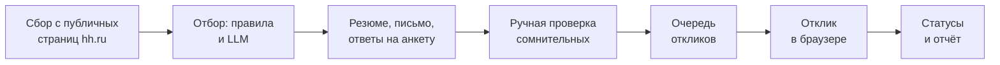

<p align="center">
  <a href="https://github.com/kondykov/hh-autoapplier-extension/actions/workflows/ci.yml"></a>
</p>

<p align="center">
  <a href="docs/USER_GUIDE.md">Инструкция</a> ·
  <a href="docs/ARCHITECTURE.md">Архитектура</a> ·
  <a href="docs/BACKEND.md">Backend и API</a> ·
  <a href="docs/ROADMAP.md">План</a>
</p>

Полуавтоматический поиск вакансий и отклики на hh.ru: расширение Chrome (MV3, TypeScript) с панелью-оверлеем и backend (ASP.NET Core + PostgreSQL), который собирает, отбирает и оценивает вакансии (правила и LLM), выбирает резюме и пишет письма.

> [!WARNING]
> Автоматизация откликов может противоречить условиям использования hh.ru. Инструмент рассчитан на личное использование с умеренной частотой и ручным вводом капчи.

## Как это работает



## Возможности

| Часть | Стек | Что делает |
|:------|:-----|:-----------|
| Backend | `ASP.NET Core` `PostgreSQL` `Docker` | Сбор с публичных страниц hh.ru, отбор по правилам поиска и LLM, выбор резюме, письмо под вакансию, ответы на анкеты, ручная проверка сомнительных (страница и Telegram-бот), пользователи и токены, статусы, отчёт |
| Расширение | `TypeScript` `Chrome MV3` | Отклики из очереди backend (пробный режим по умолчанию) с выбранным резюме и письмом, запасное письмо с `{{title}}` и `{{company}}`, выдача со страницы — на сервер как запасной сбор, сбор анкет работодателей, автоотказы |

**Отчёт.** Отклики в CSV: название, стек, компания, оплата, формат, резюме.

**Защиты.** Дневной лимит, автопауза при капче, разброс пауз между действиями.

## Быстрый старт

Расширение:

```
npm install
# создайте letter.local.txt с текстом письма (в git не попадает)
npm run build
node scripts/dev-browser.mjs                   # Chromium с расширением, войдите в hh.ru
```

Backend:

```
cd server
copy .env.example .env
docker compose up -d --build                   # http://127.0.0.1:8080/health
```

## Документация

- [docs/USER_GUIDE.md](docs/USER_GUIDE.md): инструкция пользователя — установка, настройка, ежедневная работа, проблемы
- [docs/ROADMAP.md](docs/ROADMAP.md): текущее состояние, планы и порядок доработок
- [docs/ARCHITECTURE.md](docs/ARCHITECTURE.md): модули расширения, конфиг, письма, резюме
- [docs/BACKEND.md](docs/BACKEND.md): backend и API
- [AGENTS.md](AGENTS.md) и `.rules/`: правила для ИИ-агентов, текущий статус в `.rules/context/task.md`
