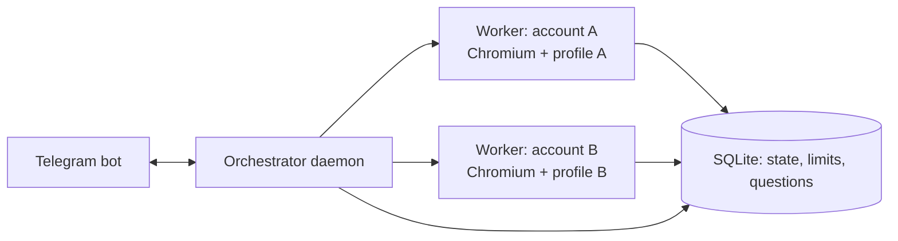

# План: автономная работа с несколькими аккаунтами на домашнем сервере

## Цели
- Несколько hh-аккаунтов работают параллельно без присмотра.
- При затыке (капча, вопросы анкеты, разлогин, лимит, ошибка) приходит уведомление в Telegram.
- Управление конкретным аккаунтом из Telegram: старт/стоп/статус/решение проблемы.

## Выбор рантайма
Расширение в обычном Chrome не годится для сервера без экрана и для нескольких аккаунтов. Вариант:
**Playwright (headed Chromium под Xvfb или в Docker) + то же ядро**, один изолированный профиль на аккаунт.
Ядро (`core`, `apply`, `search`, `questions`, `rejects`, `letters`) уже зависит только от DOM и интерфейсов
(`KeyValueStorage`, `Logger`, `Panel`-sink), поэтому его бандл инжектится в страницу Playwright'ом (`addInitScript`/`addScriptTag`),
а `ChromeStorage` заменяется на `BridgeStorage` (`page.exposeFunction` → файл/SQLite на хосте).
Расширение остаётся для ручного режима; логика одна и та же.

## Архитектура

- `orchestrator` (Node, systemd/Docker): читает `accounts.json`, запускает/останавливает воркеры, держит очередь событий, говорит с Telegram.
- `worker` (на аккаунт): persistent context `profiles/<id>`, свой прокси (опционально), свой дневной лимит, свой поиск/письмо.
- `storage`: SQLite (better-sqlite3) вместо `chrome.storage`; ключи с префиксом `accountId`.
- Секреты (токен бота, chat id, прокси) — только в `.env` / `accounts.local.json`, вне git.

## Конфиг аккаунта (`accounts.local.json`)
`id`, `label`, `profileDir`, `proxy?`, `dailyLimit`, `searchUrls[]` (пресеты), `letterTemplate | letterProvider`, `schedule` (окна работы, случайные паузы), `telegramChatId`.

## События, которые уходят в Telegram
| Событие | Действие по умолчанию | Ответ из Telegram |
|---|---|---|
| Капча / проверка | пауза воркера, скриншот в чат | «решил» → продолжить; ссылка на VNC/noVNC для ручного решения |
| Разлогин | пауза | «логин» → открыть noVNC для входа |
| Анкета работодателя (outline) | пропуск, сохранить вопросы | кнопка «ответить» → ввод ответов → автозаполнение |
| Дневной лимит | стоп до завтра | «+N» поднять лимит |
| Серия ошибок / пустая выдача | стоп после политики повторов | «рестарт» |
| Итоги дня | сводка по каждому аккаунту | — |

## Команды бота
`/accounts`, `/status [id]`, `/start id`, `/stop id`, `/next id` (один отклик), `/limit id N`, `/search id` (выбор пресета),
`/shot id` (скриншот), `/questions id` (файл анкет), `/letter id` (показать/заменить). Доступ только по whitelist chat id,
привязка chat → разрешённые аккаунты.

## Этапы
1. **Ядро без chrome.\***: вынести `KeyValueStorage`/уведомления в интерфейсы, `BridgeStorage`, `Notifier` (Telegram + console). Тесты.
2. **Один воркер на Playwright**: инжект бандла, headed под Xvfb, события `needs-human` из контроллера (детектор капчи/разлогина в `outcome-detector`).
3. **Telegram**: уведомления + ответ на событие (inline-кнопки), затем команды управления.
4. **Мультиаккаунт**: оркестратор, изоляция профилей/прокси, очередь и рандомизация расписания.
5. **Эксплуатация**: Docker + noVNC для ручного вмешательства, systemd/healthcheck, ротация логов, бэкап профилей.
6. **LLM** (параллельно): `LlmLetterProvider` и автоответы на анкеты; ключи из `.env`.

## Риски
- hh.ru может ограничивать автоматизацию и множественные аккаунты с одного IP: человекоподобные паузы, лимиты, прокси на аккаунт, не превышать разумные объёмы. Нарушение правил сервиса — на вашей ответственности.
- Автоматическое решение капчи — отдельный, менее приоритетный этап; сначала передача человеку.
- Профили содержат сессии: хранить с ограниченными правами, не коммитить.

## Открытые вопросы
Сколько аккаунтов; ОС/железо сервера (Docker доступен?); один бот на всех или бот на аккаунт; нужен ли удалённый экран (noVNC).
