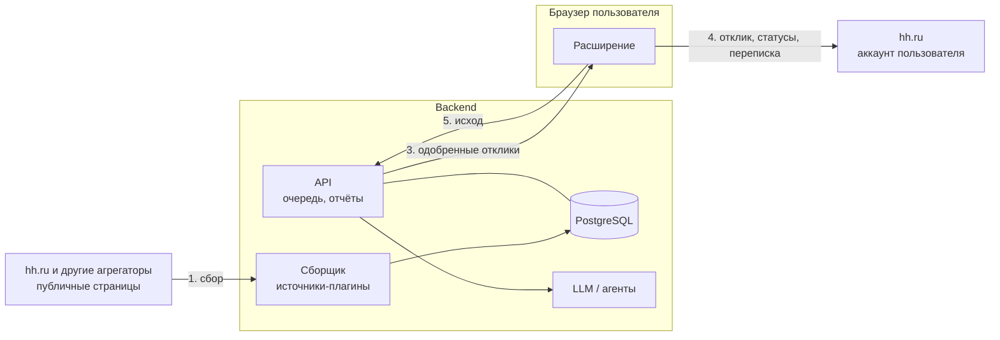

# План доработок

Сводный план: куда движется проект, что уже запланировано и в каком порядке. Текущий статус для агентов — `.rules/context/task.md`; подробности — `ARCHITECTURE.md` (расширение), `BACKEND.md` (backend).

Обновлено: 2026-10-25.

## Где проект сейчас

| Часть | Состояние |
|---|---|
| Расширение | Работает на живом hh.ru: сбор, фильтры и скоринг, автоотклик, письма, автовыбор резюме, отчёт CSV, анкеты, автоотказы, дневной лимит, автопауза при капче, проверка связи с backend, режим «из очереди». 96 тестов vitest |
| Backend | Автономный сбор с публичных страниц hh.ru (источники-плагины), поиски с правилами, оценка, выбор резюме, LLM (оценка, письма, анкеты), ручная проверка, очередь, статусы, отчёт, импорт, Docker; пользователи и роли (#7), отклик пользователя `JobApplication` с историей статусов (#8), владельцы данных (#9). 95 тестов xunit |
| Связь между ними | Расширение берёт очередь с backend через service worker и сообщает статусы (#13, #15) |

Проверено на живой странице 2026-10-24 (без отправки): выбор резюме на странице отклика и реакция панели на капчу. Не проверено: пауза посреди работающего авто-режима.

API hh.ru не используется: поиск без токена приложения отвечает 403, токена из браузера нет. Вместо него сервер читает публичные страницы поиска и вакансий hh.ru — без входа и аккаунта (проверено вживую 2026-10-23). Всё, что требует входа (отклики, статусы, переписка), делает расширение в браузере пользователя.

## Целевая схема

Цикл:

1. **Backend собирает сам.** Фоновая задача раз в интервал проходит сохранённые поиски по всем источникам. Источник — плагин `IVacancySource`: поиск отдаёт карточки, детали (описание, навыки) грузятся только для новых. Первый источник — публичные страницы hh.ru; позже — другие агрегаторы.
2. **Backend анализирует и оценивает.** Правила (быстро, дёшево) → LLM-оценка соответствия резюме → выбор резюме → письмо под вакансию → ответы на анкету → проверка → очередь одобренных откликов.
3. **Расширение откликается.** Берёт из очереди следующий одобренный отклик, открывает вакансию, выбирает резюме, вставляет письмо и ответы, отправляет, сообщает исход на сервер. Там же собирает статусы откликов и переписку — для этого нужен вход в аккаунт.

**Что это даёт.**
- Сбор автономный: работает на сервере по расписанию, без открытого браузера, токенов и аккаунтов.
- Сервер читает только публичные страницы; аккаунт hh.ru живёт только в браузере пользователя. Мультиаккаунта и Playwright-воркеров нет.
- Правила, оценка и письма — только на backend; дублирование правил в расширении исчезает.
- Бережность: случайные паузы 2–5 с, лимит страниц, детали только для новых; при капче или 403/429 сбор останавливается до следующего запуска. Защиты отклика (задержки, дневной лимит, автопауза при капче) — в расширении.

**Пользователи.** Двое, у каждого свой аккаунт hh.ru и своё расширение. На backend — свои резюме, поиски, правила, письма и очередь. Вакансия общая (один id hh), а её оценка и статус — у каждого свои.

## Направления

### A. Сбор и связка с расширением
- **Сборщик (готово):** `IVacancySource` и источник hh.ru с публичных страниц, фоновый сбор, остановка при блокировке, тесты разбора на фикстурах.
- **Другие агрегаторы:** новый источник = реализация `IVacancySource`. Когда появится второй, ключ вакансии станет «источник + внешний id» (миграция схемы; сейчас ключ — id hh). Если антибот hh.ru станет мешать — запасной путь: сбор расширением в `POST /api/import`.
- Настройки в расширении (готово, #13): адрес сервера и ключ в панели, запросы — через service worker расширения (`host_permissions`), кнопка «Проверить связь».
- **Отклик (готово, #15):** режим «из очереди» — следующий одобренный отклик → страница отклика → резюме от backend → письмо → отправка → статус на сервер (`Applied`/`Skipped`/`Failed`). Пробный режим по умолчанию: без нажатия «Отправить». Ответы на анкеты — #24 (готово): анкету без ответов расширение отправляет на сервер, LLM отвечает, следующий проход заполняет анкету.
- **Статусы и переписка:** расширение периодически собирает со страницы откликов статусы (приглашение, отказ) и сообщения работодателей и отправляет на сервер; нужно для отчёта и разбора диалогов.
- Локальные фильтры, скоринг и шаблоны писем убираются после перехода; до этого остаётся режим без сервера.

### B. Backend: анализ, оценка и LLM
- Порт `ILlmClient` в Application и реализация в Infrastructure для облачного OpenAI-совместимого API (готово, #21; решение #4); первый кандидат — Groq с бесплатным тарифом. Модель и адрес — в конфиге, провайдер меняется без правки кода.
- Тестовые задания работодателей: решения пока нет; предложение владельца — делегировать агенту opencode (`opencode serve`) с бесплатной моделью (Groq) — #33.
- Оценка вакансии под резюме (готово, #22): прошедшие правила ждут LLM (`Pending`), вердикт «подходит / сомнительно / не подходит», балл, резюме и причина; журнал запросов `LlmCalls`.
- Письмо под вакансию (готово, #23): по резюме и его шаблону письма (`LetterTemplate`) для вакансий в очереди, после оценки; уходит в расширение с очередью.
- Ответы на анкеты (готово, #24): вопросы видны только со входом — их присылает расширение; LLM отвечает, вакансия с ответами сразу в очереди (решение владельца 2026-10-25), неполный ответ — пропуск.
- Ручная проверка (готово, #25): сомнительные по LLM — статус `Review`, страница `/review.html` на backend: одобрить (можно поправить письмо) или отклонить; правило поиска `skipReview` — без проверки. Telegram — #28.
- Задачи для LLM: анализ резюме и вакансии, балл и объяснение, письмо, ответы на вопросы анкеты, разбор ответов работодателей и предложение ответа.
- LLM-запросы — фоновые задачи с повторами и лимитом расходов; результат сохраняется с промптом и версией модели.
- Отбор и подготовка — на backend: в расширение приходят только отобранные вакансии вместе с письмами; исключения — анкеты и диалоги в чатах.
- Ручная проверка — только сомнительных (балл ниже порога из правил поиска или есть анкета): «одобрить», «поправить письмо», «отклонить» — на веб-странице backend и в Telegram-боте. Остальное уходит в очередь само.
- Диалоги с работодателями: LLM разбирает ответ (приглашение, отказ, вопрос) и предлагает текст ответа; отправляет человек.
- Данные резюме и переписки уходят к провайдеру LLM — принято владельцем (#4).

### C. Пользователи и доступ (RBAC)
- Пользователи и роли (готово, #7): ASP.NET Core Identity в той же БД, роли `Admin` (пользователи и общие настройки) и `User` (только своё). Пользователей создаёт администратор, первый — из `.env` при старте. Вход по email и паролю → cookie `hh_auth`; блокировка, смена роли и пароля, лимит неудачных входов. `X-Api-Key` с #9 — от имени пользователя ключа с ролью `User`. Подробно — `BACKEND.md`, «Пользователи и вход».
- Отклик пользователя (готово, #8): `Vacancy` — общая карточка, оценка и статус — в агрегате `JobApplication` (пользователь, вакансия, статус, балл, резюме, вердикт LLM, письмо, анкета с ответами, история статусов). Имя `JobApplication` — чтобы не путать со слоем `Application` (решение владельца 2026-10-25). Миграция `JobApplications` перенесла данные: по отклику на вакансию. `UserId = null` — владелец по умолчанию, пока нет пользователей. API не изменился, в ответах вакансий добавлено поле `history`.
- Владельцы данных (готово, #9): поиски и резюме — у пользователя (`UserId`, имена уникальны в пределах пользователя), отклик хранит поиск владельца `SearchId` (его правила — для LLM). Эндпоинты данных — любому вошедшему со своими данными; `Admin` читает чужое по `?userId=`; `/api/users*`, `/api/collect`, `/api/llm/*` — только `Admin`. `X-Api-Key` — от имени `API_KEY_USER` или администратора из `ADMIN_EMAIL`, всегда с ролью `User`. При старте данные без владельца переходят администратору из `ADMIN_EMAIL`; сборщик и LLM проходят по всем пользователям. Миграция `DataOwners`. Открыто: каскадное удаление данных пользователя (решить про мягкое удаление), последняя запись побеждает при одновременной смене статуса. Подробно — `BACKEND.md`, «Владельцы данных и доступ».
- Персональные токены (готово, #10): `/api/tokens` — выпуск после входа по паролю, отзыв; токен в заголовке `X-Api-Key`, от имени владельца с ролью `User`; в базе только хэш. Общий ключ пока оставлен для перехода — убрать в #42.
- Новые зависимости и миграции — согласовать с владельцем.

### D. Архитектура кода
**Backend — DDD и простой CQRS без MediatR (готово, [ADR 0001](adr/0001-backend-ddd-cqrs.md)).**
- Слои-проекты: `Domain` (агрегаты, value objects) ← `Application` (команды, запросы, обработчики, DTO, порты) ← `Infrastructure` (EF, источники вакансий, LLM) ← `Api` (контроллеры, OpenAPI + Scalar).
- Результаты сценариев — `OneOf` с именованным типом на каждый сценарий; на .NET 11 меняется только объявление на `union`.
- Модули по функциям: `Identity`, `Vacancies`, `Sources`, `Applications`, `Resumes`, `Letters`, `Llm`. Эндпоинты по модулям (`MapGroup` в отдельных файлах), `Program.cs` только собирает приложение; импорт и CSV уходят из `Program.cs`.
- Фоновые задачи (LLM) — через очередь в БД и `BackgroundService`, без внешнего брокера.
- Тесты: юнит на Domain, интеграционные на API через `WebApplicationFactory` и Postgres в Testcontainers (готово, #12).

**Расширение — сбор и исполнение, слои «порты и адаптеры».**
- `core` — сценарии и состояние без DOM и `chrome.*`; `pages` — шаги по типу страницы (`PageStep`: выдача, вакансия, очередь, отказы; готово, #18), `Controller` только собирает их и выбирает шаг; `hh` — селекторы и DOM hh.ru; `api` — клиент backend; `infra`, `ui` — как сейчас.

**Общее:** контракт API — OpenAPI (генерирует backend), клиент в расширении сверяется с ним; решения — короткие ADR в `docs/adr/`.

### E. Сервер дома и доступ из WAN
Нужен, когда backend работает для двух человек или с LLM на своём железе. До этого backend можно держать локально (`docker compose` на 127.0.0.1).

Наружу не открывать ни одного порта API или БД.

| Вариант | Плюсы | Минусы |
|---|---|---|
| **Tailscale** (рекомендуется для начала) | Бесплатно для личного использования, без проброса портов, WireGuard внутри, вход через аккаунт, ACL: устройству видно только порт API | Координационный сервер у компании Tailscale |
| **Headscale + клиенты Tailscale** | То же, но координация на своём сервере | Нужен проброс одного порта или VPS для Headscale |
| **WireGuard на роутере или сервере** | Полностью своё, быстро | Проброс UDP-порта, белый IP или DDNS, ключи вручную |
| **OpenVPN** (рассматривает владелец) | Полностью своё, клиенты под все ОС, часто есть в прошивке роутера | Проброс порта, белый IP или DDNS, своя PKI для сертификатов; медленнее WireGuard |
| Cloudflare Tunnel + Access | Без проброса, доступ по почте | API торчит в интернет за Cloudflare; не рекомендуется для API |

Общие правила: сервер в отдельной сети или VLAN (иначе firewall: входящие только из VPN и только на порт API); API слушает интерфейс VPN, Postgres — только внутри Docker; TLS даже внутри VPN (Tailscale выдаёт сертификаты `*.ts.net`); персональные токены и ограничение частоты входа; обновления, бэкап БД, логи входов.

### F. Уведомления
Telegram-бот на backend (#28, первая итерация): чат привязывается одноразовым кодом после входа по паролю; уведомления — отклик на проверке (кнопки «Одобрить» / «Отклонить»), капча и дневной лимит в расширении, анкета без ответа LLM, администратору — сбои сбора и LLM; команды `/status`, `/review`, `/stop`. Ответы работодателей — после разбора диалогов #26. Подробно — `BACKEND.md`, «Telegram».

### G. Ведение задач
- Задачи — GitHub Issues в [kondykov/hh-autoapplier-extension](https://github.com/kondykov/hh-autoapplier-extension/issues) (позже переименуется в `hh-autoapplier`); статус, сроки и шкала — в [GitHub Project «hh-autoapplier»](https://github.com/users/kondykov/projects/5) (поля «Приоритет», «Начало», «Срок»); этот файл — схема, решения и порядок.
- Метки: направление (`backend`, `extension`, `llm`, `rbac`, `infra`, `docs`), тип (`feature`, `chore`, `question`), приоритет (`p1`–`p3`); этапы — milestones.
- В коммите `refs #N`, в PR `closes #N`. Создавать и закрывать issues — по просьбе владельца.

## Технический долг

- Правила продублированы и расходятся: поля (`stopWords`/`requiredStack` против `ExcludeKeywords`/`IncludeKeywords`, на сервере есть `RequireSalary` и `SkipWithTest`), ключевые слова резюме (`wpf`, `wordpress` только в расширении). Закрывается направлением A.
- `DELAYS` фиксированные; нужен случайный разброс (меняет частоту запросов — согласовать).
- Пароль первого администратора — в `.env` открытым текстом (`ADMIN_PASSWORD`): при развёртывании на сервере (#5) его легко скомпрометировать (бэкапы, `docker inspect`, переменные окружения контейнера). Пока — пометка и ручная очистка после первого старта (решение владельца 2026-10-26). Для #5: одноразовая команда создания администратора (`dotnet HhAutoApplier.Api.dll create-admin`) или Docker secrets вместо переменной.
- CORS (готово, #20): по умолчанию выключен, чужие источники — только через `CORS_ORIGINS`.
- Версии `package.json` и `manifest.json` (0.4.0) поднимать вместе.
- В профиле dev-браузера старое PHP-письмо — заменить в панели.
- Репозиторий — форк `pant42/js_script`: старые коммиты остаются доступны по SHA в сети форков GitHub и в ссылках PR, а исходные скрипты коллеги — в его публичном репозитории. Для публикации чистого репозитория — новый репозиторий не-форк (или отвязка форка через поддержку GitHub). История `master` и `develop` вычищена 2026-10-25 (#30).

## Порядок

Этапы — milestones в GitHub, задачи — issues в [kondykov/hh-autoapplier-extension](https://github.com/kondykov/hh-autoapplier-extension/issues), шкала и статусы — [Project](https://github.com/users/kondykov/projects/5). Сроков у этапов нет: работа идёт по спринтам до их завершения.

1. **Основа** ([milestone](https://github.com/kondykov/hh-autoapplier-extension/milestone/1), готово). CI #1, живая проверка выбора резюме и автопаузы #2, ADR #3, решения владельца #4.
2. **Связка расширения и backend** ([milestone](https://github.com/kondykov/hh-autoapplier-extension/milestone/2), локально). Сборщик с источниками-плагинами и источник hh.ru #31 (готово), настройки сервера #13 (готово), режим «из очереди» #15, тесты конвейера отклика #17, `PageStep` #18 (готово), модули backend и логика вне `Program.cs` #11, интеграционные тесты API #12, CORS #20, разброс задержек #19.
3. **LLM** ([milestone](https://github.com/kondykov/hh-autoapplier-extension/milestone/3)). `ILlmClient` #21 (готово), оценка #22 (готово), письма #23 (готово), ответы на анкеты #24 (готово), ручная проверка #25 (готово), удаление локальных правил из расширения #27; затем сбор переписки и разбор диалогов #26.
4. **Пользователи и сервер дома** ([milestone](https://github.com/kondykov/hh-autoapplier-extension/milestone/4)). Identity и роли #7 (готово), отклик пользователя `JobApplication` #8 (готово), владельцы данных #9 (готово), персональные токены #10 (готово), развёртывание #5, VPN, firewall и TLS #6.
5. **Уведомления** ([milestone](https://github.com/kondykov/hh-autoapplier-extension/milestone/5)). Telegram #28.

### Спринты

Спринт — набор задач без дат (поле «Спринт» в [Project](https://github.com/users/kondykov/projects/5)): закрывается, когда сделаны все его задачи, после этого начинается следующий. Порядок: этапы по зависимостям, внутри — P1 → P3, P3 в конце. Новые задачи добавляются в подходящий незакрытый спринт; в статусе Project в Todo — только задачи спринта в работе, остальные — в Backlog; у сделанных задач в project остаются фактические даты «Начало»/«Срок».

| Спринт | Цель | Задачи |
|---|---|---|
| 1 | Связка: режим «из очереди» | #4 #17 #15 #12 |
| 2 | Рефакторинг расширения и клиент LLM | #18 #21 #22 |
| 3 | LLM: письма, анкеты, ручная проверка | #23 #24 #25 |
| 4 | Сервер дома: чистка истории git (#5, #6 отложены — нет решения о сервере и VPN) | #30 |
| 5 | Пользователи и отклик пользователя | #7 #8 |
| 6 | Владельцы данных и доступ | #9 #10 #20 |
| 7 | Уведомления и чистка | #28 #19 #27 |
| 8 | Диалоги, тестовые задания, новые агрегаторы | #26 #33 #32 |

Отложены до решения владельца о сервере и VPN: развёртывание #5, доступ из WAN #6 (в Backlog, без спринта). Сняты и закрыты: токен API hh.ru #16, Playwright-воркер #29, сбор расширением #14 (заменён серверным сбором, остаётся запасным путём). Позже: другие агрегаторы и ключ «источник + id» — #32. Анонимный локальный вход с профилями по имени — #41 (предложение владельца 2026-10-26). Подробный профиль кандидата для LLM (общая часть и факты по навыкам) — #35, после основы. Инструкция для пользователей (wiki или `docs/USER_GUIDE.md`) — #37, публикация для других — после #30.

## Решения владельца

Приняты 2026-10-24 в #4.

| Вопрос | Решение |
|---|---|
| LLM | Облачный OpenAI-совместимый API; первый кандидат — Groq (бесплатный тариф) |
| Ручная проверка | Только сомнительные: балл ниже порога или анкета; остальное уходит само |
| Где одобрять | На backend: веб-страница и Telegram-бот; в расширение — только отобранное с письмами |
| Анкеты и чаты | Анкеты: ответы LLM сразу в очередь — анонимно вопросы не получить (2026-10-25, #24); чаты — человек |
| Тестовые задания | Решения нет; предложение — opencode с бесплатной моделью (#33) |
| Диалоги | Анализ и подсказка ответа, отправляет человек |
| Сервер и VPN | 2026-10-25: отложено, где сервер — не решено; VPN — возможно OpenVPN или аналог. #5 и #6 в Backlog, до решения всё локально |
| История git | 2026-10-25: вычистить сейчас, force push в `master` и `develop` согласован (#30) |
| Регистрация | 2026-10-25: только администратор создаёт пользователей, саморегистрации нет; Identity — пакет `Microsoft.AspNetCore.Identity.EntityFrameworkCore` согласован (#7) |
| Общий ключ до #10 | 2026-10-25: действует от имени `API_KEY_USER` или администратора из `ADMIN_EMAIL`, всегда с ролью `User` — самый безопасный вариант (#9; прежнее решение #7 — роль `Admin` без учётной записи — заменено); пустой ключ выключает только вход по ключу |
| Admin видит чужое | 2026-10-25: по умолчанию — свои данные; чужие — по `?userId=`, только чтение (#9) |
| Имя отклика | 2026-10-25: агрегат `JobApplication`, а не `Application` — не путать со слоем и пространством имён `HhAutoApplier.Application` (#8) |
| Спринт 7 | 2026-10-26: в работу, начать с Telegram #28; #19 — разброс ±30% к текущим задержкам; #27 — сначала разобрать сценарии локального режима, решение после |
| Telegram | 2026-10-26: чат привязывается одноразовым кодом из API (`/start <код>`), а не whitelist в `.env`; пакет `Telegram.Bot` (22.10, только в Infrastructure); первая итерация — проверка кнопками, события расширения, команды чтения, сбои сервера администратору (#28) |
