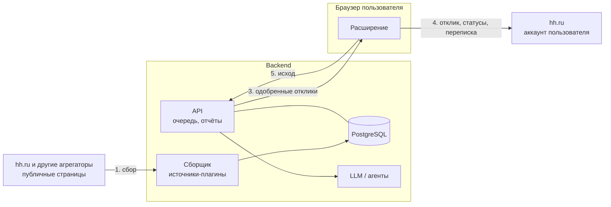

# План доработок

Сводный план: куда движется проект, что уже запланировано и в каком порядке. Текущий статус для агентов — `.rules/context/task.md`; подробности — `ARCHITECTURE.md` (расширение), `BACKEND.md` (backend).

Обновлено: 2026-10-23.

## Где проект сейчас

| Часть | Состояние |
|---|---|
| Расширение | Работает на живом hh.ru: сбор, фильтры и скоринг, автоотклик, письма, автовыбор резюме, отчёт CSV, анкеты, автоотказы, дневной лимит, автопауза при капче, проверка связи с backend. 41 тест vitest |
| Backend | Автономный сбор с публичных страниц hh.ru (источники-плагины), поиски с правилами, оценка, выбор резюме, очередь, статусы, отчёт, импорт, Docker. Один пользователь, без LLM. 13 тестов xunit |
| Связь между ними | Нет: расширение и backend работают независимо |

Проверено на живой странице 2026-10-24 (без отправки): выбор резюме на странице отклика и реакция панели на капчу. Не проверено: пауза посреди работающего авто-режима.

API hh.ru не используется: поиск без токена приложения отвечает 403, токена из браузера нет. Вместо него сервер читает публичные страницы поиска и вакансий hh.ru — без входа и аккаунта (проверено вживую 2026-10-23). Всё, что требует входа (отклики, статусы, переписка), делает расширение в браузере пользователя.

## Целевая схема

Цикл:

1. **Backend собирает сам.** Фоновая задача раз в интервал проходит сохранённые поиски по всем источникам. Источник — плагин `IVacancySource`: поиск отдаёт карточки, детали (описание, навыки) грузятся только для новых. Первый источник — публичные страницы hh.ru; позже — другие агрегаторы.
2. **Backend анализирует и оценивает.** Правила (быстро, дёшево) → LLM-оценка соответствия резюме → выбор резюме → письмо под вакансию → ответы на анкету → проверка → очередь одобренных откликов.
3. **Расширение откликается.** Берёт из очереди следующий одобренный отклик, открывает вакансию, выбирает резюме, вставляет письмо и ответы, отправляет, сообщает исход на сервер. Там же собирает статусы откликов и переписку — для этого нужен вход в аккаунт.

**Что это даёт.**
- Сбор автономный: работает на сервере по расписанию, без открытого браузера, токенов и аккаунтов.
- Сервер читает только публичные страницы; аккаунт hh.ru живёт только в браузере пользователя. Мультиаккаунта и Playwright-воркеров нет.
- Правила, оценка и письма — только на backend; дублирование правил в расширении исчезает.
- Бережность: случайные паузы 2–5 с, лимит страниц, детали только для новых; при капче или 403/429 сбор останавливается до следующего запуска. Защиты отклика (задержки, дневной лимит, автопауза при капче) — в расширении.

**Пользователи.** Двое, у каждого свой аккаунт hh.ru и своё расширение. На backend — свои резюме, поиски, правила, письма и очередь. Вакансия общая (один id hh), а её оценка и статус — у каждого свои.

## Направления

### A. Сбор и связка с расширением
- **Сборщик (готово):** `IVacancySource` и источник hh.ru с публичных страниц, фоновый сбор, остановка при блокировке, тесты разбора на фикстурах.
- **Другие агрегаторы:** новый источник = реализация `IVacancySource`. Когда появится второй, ключ вакансии станет «источник + внешний id» (миграция схемы; сейчас ключ — id hh). Если антибот hh.ru станет мешать — запасной путь: сбор расширением в `POST /api/import`.
- Настройки в расширении (готово, #13): адрес сервера и ключ в панели, запросы — через service worker расширения (`host_permissions`), кнопка «Проверить связь».
- **Отклик:** режим «из очереди» — следующий одобренный отклик → вакансия → резюме → письмо и ответы → отправка → статус и исход (успех, анкета, ошибка, капча) на сервер.
- **Статусы и переписка:** расширение периодически собирает со страницы откликов статусы (приглашение, отказ) и сообщения работодателей и отправляет на сервер; нужно для отчёта и разбора диалогов.
- Локальные фильтры, скоринг и шаблоны писем убираются после перехода; до этого остаётся режим без сервера.

### B. Backend: анализ, оценка и LLM
- Порт `ILlmClient` в Application и реализации в Infrastructure: OpenAI-совместимое API (облачный провайдер или локальная модель), агент на opencode (`opencode serve`, HTTP API) для сложных задач.
- Задачи для LLM: анализ резюме и вакансии, балл и объяснение, письмо, ответы на вопросы анкеты, разбор ответов работодателей и предложение ответа.
- LLM-запросы — фоновые задачи с повторами и лимитом расходов; результат сохраняется с промптом и версией модели.
- Ручная проверка: «одобрить», «поправить письмо», «отклонить» — в панели расширения или веб-интерфейсе. Режим без проверки включается правилом пользователя.
- Данные резюме и переписки уходят к провайдеру LLM; для чувствительных данных — локальная модель. Выбор за владельцем.

### C. Пользователи и доступ (RBAC)
- `User`, роли `Admin` (пользователи и общие настройки) и `User` (только своё).
- Вакансия общая, оценка и статус — в новой сущности «отклик пользователя» (`Application`: пользователь, вакансия, балл, резюме, письмо, ответы, статус, история). Сейчас `Status`, `Score`, `ResumeProfile` лежат в `Vacancy` — главная миграция схемы.
- У поисков, резюме, правил и писем — владелец; все запросы API фильтруются по текущему пользователю.
- Вход по логину и паролю (ASP.NET Core Identity) и персональный токен для расширения вместо общего `X-Api-Key`; токен можно отозвать.
- Новые зависимости и миграции — согласовать с владельцем.

### D. Архитектура кода
**Backend — DDD и простой CQRS без MediatR (готово, [ADR 0001](adr/0001-backend-ddd-cqrs.md)).**
- Слои-проекты: `Domain` (агрегаты, value objects) ← `Application` (команды, запросы, обработчики, DTO, порты) ← `Infrastructure` (EF, источники вакансий, LLM) ← `Api` (контроллеры, OpenAPI + Scalar).
- Результаты сценариев — `OneOf` с именованным типом на каждый сценарий; на .NET 11 меняется только объявление на `union`.
- Модули по функциям: `Identity`, `Vacancies`, `Sources`, `Applications`, `Resumes`, `Letters`, `Llm`. Эндпоинты по модулям (`MapGroup` в отдельных файлах), `Program.cs` только собирает приложение; импорт и CSV уходят из `Program.cs`.
- Фоновые задачи (LLM) — через очередь в БД и `BackgroundService`, без внешнего брокера.
- Тесты: юнит на Domain, интеграционные на API через `WebApplicationFactory` и тестовый Postgres (#12).

**Расширение — сбор и исполнение, слои «порты и адаптеры».**
- `core` — сценарии и состояние без DOM и `chrome.*`; `pages` — шаги по типу страницы (`PageStep`: выдача, вакансия, отклик, список откликов) вместо одного `Controller` на 416 строк; `hh` — селекторы и DOM hh.ru; `api` — клиент backend; `infra`, `ui` — как сейчас.

**Общее:** контракт API — OpenAPI (генерирует backend), клиент в расширении сверяется с ним; решения — короткие ADR в `docs/adr/`.

### E. Сервер дома и доступ из WAN
Нужен, когда backend работает для двух человек или с LLM на своём железе. До этого backend можно держать локально (`docker compose` на 127.0.0.1).

Наружу не открывать ни одного порта API или БД.

| Вариант | Плюсы | Минусы |
|---|---|---|
| **Tailscale** (рекомендуется для начала) | Бесплатно для личного использования, без проброса портов, WireGuard внутри, вход через аккаунт, ACL: устройству видно только порт API | Координационный сервер у компании Tailscale |
| **Headscale + клиенты Tailscale** | То же, но координация на своём сервере | Нужен проброс одного порта или VPS для Headscale |
| **WireGuard на роутере или сервере** | Полностью своё, быстро | Проброс UDP-порта, белый IP или DDNS, ключи вручную |
| Cloudflare Tunnel + Access | Без проброса, доступ по почте | API торчит в интернет за Cloudflare; не рекомендуется для API |

Общие правила: сервер в отдельной сети или VLAN (иначе firewall: входящие только из VPN и только на порт API); API слушает интерфейс VPN, Postgres — только внутри Docker; TLS даже внутри VPN (Tailscale выдаёт сертификаты `*.ts.net`); персональные токены и ограничение частоты входа; обновления, бэкап БД, логи входов.

### F. Уведомления
Telegram-бот на backend: события (капча в расширении, анкета без ответов, ответ работодателя, исчерпан лимит), ответы на них и команды. Доступ по whitelist chat id.

### G. Ведение задач
- Задачи — GitHub Issues в [kondykov/hh-autoapplier-extension](https://github.com/kondykov/hh-autoapplier-extension/issues) (позже переименуется в `hh-autoapplier`); статус, сроки и шкала — в [GitHub Project «hh-autoapplier»](https://github.com/users/kondykov/projects/5) (поля «Приоритет», «Начало», «Срок»); этот файл — схема, решения и порядок.
- Метки: направление (`backend`, `extension`, `llm`, `rbac`, `infra`, `docs`), тип (`feature`, `chore`, `question`), приоритет (`p1`–`p3`); этапы — milestones.
- В коммите `refs #N`, в PR `closes #N`. Создавать и закрывать issues — по просьбе владельца.

## Технический долг

- Правила продублированы и расходятся: поля (`stopWords`/`requiredStack` против `ExcludeKeywords`/`IncludeKeywords`, на сервере есть `RequireSalary` и `SkipWithTest`), ключевые слова резюме (`wpf`, `wordpress` только в расширении). Закрывается направлением A.
- Нет тестов на `ApplyPipeline`, `submit`, `ResumeSelector`, `Controller` и на API.
- `DELAYS` фиксированные; нужен случайный разброс (меняет частоту запросов — согласовать).
- CORS `AllowAnyOrigin`; после связки — только источник расширения.
- Версии `package.json` и `manifest.json` (0.4.0) поднимать вместе.
- В профиле dev-браузера старое PHP-письмо — заменить в панели.
- Перед публикацией репозитория вычистить из истории git старые скрипты с личными данными коллеги (`legacy/`).

## Порядок

Этапы — milestones в GitHub, задачи — issues в [kondykov/hh-autoapplier-extension](https://github.com/kondykov/hh-autoapplier-extension/issues), шкала и статусы — [Project](https://github.com/users/kondykov/projects/5). Сроков у этапов нет: работа идёт по спринтам до их завершения.

1. **Основа** ([milestone](https://github.com/kondykov/hh-autoapplier-extension/milestone/1)). CI #1 (готово), живая проверка выбора резюме и автопаузы #2 (готово), ADR #3, решения владельца #4.
2. **Связка расширения и backend** ([milestone](https://github.com/kondykov/hh-autoapplier-extension/milestone/2), локально). Сборщик с источниками-плагинами и источник hh.ru #31 (готово), настройки сервера #13 (готово), режим «из очереди» #15, тесты конвейера отклика #17, `PageStep` #18, модули backend и логика вне `Program.cs` #11, интеграционные тесты API #12, CORS #20, разброс задержек #19.
3. **LLM** ([milestone](https://github.com/kondykov/hh-autoapplier-extension/milestone/3)). `ILlmClient` #21, оценка #22, письма #23, ответы на анкеты #24, ручная проверка #25, удаление локальных правил из расширения #27; затем сбор переписки и разбор диалогов #26.
4. **Пользователи и сервер дома** ([milestone](https://github.com/kondykov/hh-autoapplier-extension/milestone/4)). Identity и роли #7, `Application` #8, владельцы данных #9, персональные токены #10, развёртывание #5, VPN, firewall и TLS #6.
5. **Уведомления** ([milestone](https://github.com/kondykov/hh-autoapplier-extension/milestone/5)). Telegram #28.

### Спринты

Спринт — набор задач без дат (поле «Спринт» в [Project](https://github.com/users/kondykov/projects/5)): закрывается, когда сделаны все его задачи, после этого начинается следующий. Порядок: этапы по зависимостям, внутри — P1 → P3, P3 в конце. Новые задачи добавляются в подходящий незакрытый спринт; у сделанных задач в project остаются фактические даты «Начало»/«Срок».

| Спринт | Цель | Задачи |
|---|---|---|
| 1 | Связка: режим «из очереди» | #4 #17 #15 #12 |
| 2 | Рефакторинг расширения и клиент LLM | #18 #21 #22 |
| 3 | LLM: письма, анкеты, ручная проверка | #23 #24 #25 |
| 4 | Сервер дома | #5 #6 #30 |
| 5 | Пользователи и отклик пользователя | #7 #8 |
| 6 | Владельцы данных и доступ | #9 #10 #20 |
| 7 | Уведомления и чистка | #28 #19 #27 |
| 8 | Диалоги и новые агрегаторы | #26 #32 |

Вне этапов: чистка истории git от данных коллеги #30. Сняты и закрыты: токен API hh.ru #16, Playwright-воркер #29, сбор расширением #14 (заменён серверным сбором, остаётся запасным путём). Позже: другие агрегаторы и ключ «источник + id» — #32.

## Открытые вопросы владельцу

Обсуждение и ответы — в #4.

- Какой LLM: облачный провайдер, локальная модель или opencode с провайдером? Есть ли GPU на сервере?
- Ручная проверка каждого отклика или только для сомнительных (балл ниже порога)?
- Проверка откликов — в панели расширения, в веб-интерфейсе или в Telegram?
- ОС сервера и роутер (умеет ли VLAN)? Устраивает ли Tailscale или нужно своё (Headscale/WireGuard)?
- Диалоги с работодателями: только анализ и подсказка ответа или отправка ответа тоже?
