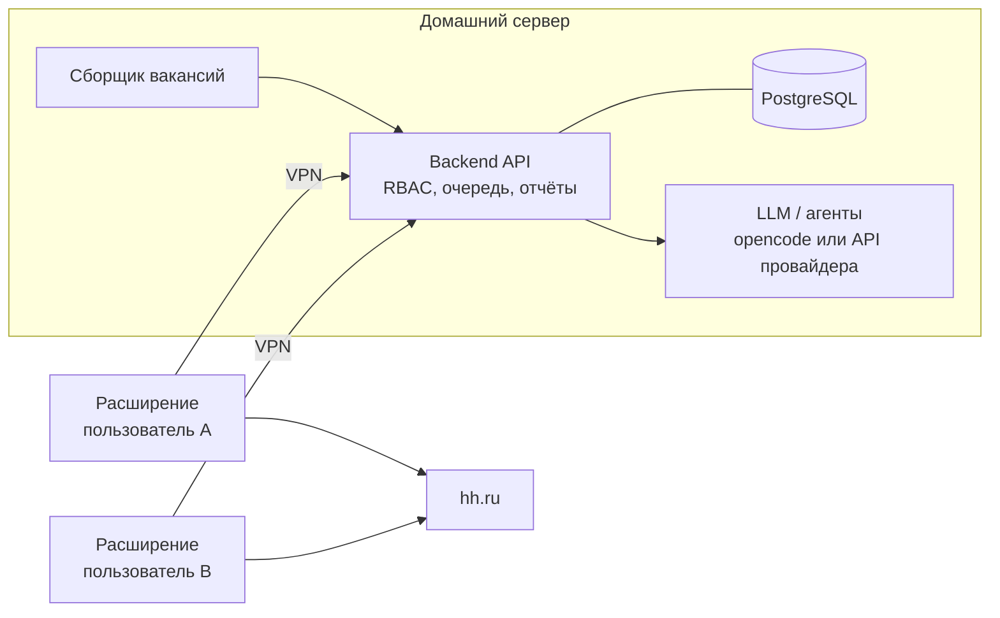

# План доработок

Сводный план: куда движется проект, что уже было запланировано и что сделать по шагам. Текущий статус для агентов — `.rules/context/task.md`; подробности — `ARCHITECTURE.md`, `BACKEND.md`, `MULTI_ACCOUNT_PLAN.md`.

Обновлено: 2026-10-23.

## Где проект сейчас

| Часть | Состояние |
|---|---|
| Расширение | Работает на живом hh.ru: сбор, фильтры и скоринг, автоотклик, письма, автовыбор резюме, отчёт CSV, анкеты, автоотказы, дневной лимит, автопауза при капче. 29 тестов vitest |
| Backend | Поиски с правилами, оценка, выбор резюме, очередь, статусы, отчёт, импорт, Docker. Один пользователь, без LLM. 5 тестов xunit |
| Связь между ними | Нет: расширение и backend работают независимо |

Не проверено на живых данных: клик по выбору резюме в списке hh.ru, автопауза при капче, сбор через API hh.ru.

Блокер: `api.hh.ru` отвечает 403 без токена приложения (регистрация на dev.hh.ru).

## Целевая схема

**Backend — мозг.** Собирает и хранит вакансии, оценивает их правилами и LLM, выбирает резюме, готовит отклик целиком: сопроводительное письмо, ответы на анкету. Отклик попадает в очередь пользователя только после проверки: правилами, LLM и при желании вручную.

**Расширение — исполнитель.** Под пользователем забирает из backend готовые проверенные отклики, открывает вакансию, выбирает указанное резюме, вставляет письмо и ответы, отправляет и сообщает результат. Своих фильтров, скоринга и шаблонов писем у расширения больше нет: дублирование правил исчезает само.

**Пользователи.** Двое, у каждого свой аккаунт hh.ru, свои резюме, поиски, правила, письма и очередь. Вакансия общая (один и тот же id hh), а её оценка и статус — у каждого пользователя свои.

## Направления

### A. Backend: пользователи и доступ (RBAC)
- Сущности: `User`, роли `Admin` (управляет пользователями и общими настройками) и `User` (видит только своё).
- Вакансия остаётся общей, статус и оценка переезжают в новую сущность «отклик пользователя» (`Application`: пользователь, вакансия, балл, резюме, письмо, ответы, статус, история). Сейчас `Status`, `Score`, `ResumeProfile` лежат прямо в `Vacancy` — это главная миграция схемы.
- У поисков, резюме, правил и писем появляется владелец; все запросы API фильтруются по текущему пользователю.
- Аутентификация: вход по логину и паролю (ASP.NET Core Identity) и персональный токен для расширения вместо общего `X-Api-Key`. Токен можно отозвать.
- Решение по библиотеке и схеме — согласовать с владельцем (новые зависимости, миграции).

### B. Backend: подготовка откликов и LLM
- Конвейер на сервере: сбор → правила (быстро, дёшево) → LLM-оценка соответствия резюме → выбор резюме → письмо под вакансию → ответы на анкету → проверка → очередь.
- Интерфейс `ILlmClient` в Core и реализации в Infrastructure: OpenAI-совместимое API (облачный провайдер или локальная модель), агент на opencode (`opencode serve`, HTTP API) для сложных задач.
- Задачи для LLM: анализ резюме и вакансии, балл и объяснение, письмо, ответы на вопросы анкеты, разбор ответов работодателей в диалогах и предложения ответа.
- LLM-запросы — фоновые задачи с повторами и лимитом расходов; результат сохраняется вместе с промптом и версией модели, чтобы можно было разобрать ошибку.
- Ручная проверка: в API и позже в веб-интерфейсе — «одобрить», «поправить письмо», «отклонить». Режим без проверки включается правилом пользователя.
- Данные резюме и переписки уходят к провайдеру LLM. Для чувствительных данных — локальная модель; выбор за владельцем.

### C. Расширение как клиент backend
- Настройки: адрес сервера и персональный токен; `host_permissions` в `manifest.json` для адреса сервера.
- Режим «из очереди»: получить следующий одобренный отклик → открыть вакансию → выбрать резюме → вставить письмо и ответы → отправить → отправить статус и исход (успех, анкета, ошибка, капча) на сервер.
- Сбор с выдачи сохраняется как источник вакансий: карточки уходят в `POST /api/import`, пока нет токена API hh.ru.
- Защитные механизмы остаются на клиенте: дневной лимит, задержки, автопауза при капче. Лимит задаёт сервер, клиент его соблюдает.
- Локальные фильтры, скоринг и шаблоны писем убираются после перехода; до этого — режим без сервера.

### D. Архитектура кода
**Backend — модульный монолит по Clean Architecture.**
- Слои остаются: `Core` (домен, правила, интерфейсы) ← `Infrastructure` (EF, hh API, LLM) ← `Api`.
- Внутри — модули по функциям: `Identity`, `Vacancies`, `Applications`, `Resumes`, `Letters`, `Llm`, `Collecting`. Каждый модуль — свои сущности, сервисы, эндпоинты.
- Эндпоинты по модулям (`MapGroup` в отдельных файлах), `Program.cs` только собирает приложение. Логика импорта и CSV уходит из `Program.cs`.
- Фоновые задачи (сбор, LLM) — через очередь в БД и `BackgroundService`, без внешнего брокера, пока хватает.
- Тесты: юнит на Core, интеграционные на API через `WebApplicationFactory` и тестовый Postgres.

**Расширение — тонкий клиент, слои «порты и адаптеры».**
- `core` — сценарии и состояние, без DOM и `chrome.*`; `pages` — шаги по типу страницы (`PageStep` для выдачи, вакансии, отклика) вместо одного `Controller` на 416 строк; `hh` — селекторы и работа с DOM hh.ru; `api` — клиент backend; `infra`, `ui` — как сейчас.
- Ядро не знает, где работает: тот же код подходит для будущего Playwright-воркера.

**Общее:** контракт API описан в OpenAPI (генерируется backend), клиент в расширении сверяется с ним; ADR — короткие записи о решениях в `docs/adr/`.

### E. Доступ из WAN
Сервер дома; наружу не открывать ни одного порта API или БД.

| Вариант | Плюсы | Минусы |
|---|---|---|
| **Tailscale** (рекомендуется для начала) | Бесплатно для личного использования, без проброса портов, WireGuard внутри, вход через аккаунт, ACL: устройству видно только порт API | Координационный сервер у компании Tailscale |
| **Headscale + клиенты Tailscale** | То же, но координация на своём сервере | Нужен проброс одного порта или VPS для Headscale, больше настройки |
| **WireGuard на роутере или сервере** | Полностью своё, быстро | Проброс UDP-порта, белый IP или DDNS, ключи раздавать вручную |
| Cloudflare Tunnel + Access | Без проброса, доступ по почте | API торчит в интернет за Cloudflare, расширению сложнее проходить Access; не рекомендуется для API |

Общие правила для любого варианта:
- Сервер в отдельной сети или VLAN, если роутер умеет; иначе — firewall на сервере: входящие только из VPN и только на порт API.
- API слушает интерфейс VPN, Postgres — только локально внутри Docker.
- TLS на API даже внутри VPN (Tailscale выдаёт сертификаты для `*.ts.net`), персональные токены, ограничение частоты запросов на вход.
- Обновления ОС и контейнеров, бэкап БД и профилей, логи входов.

### F. Ведение задач
- Источник задач — GitHub Issues в [kondykov/hh-autoapplier-extension](https://github.com/kondykov/hh-autoapplier-extension/issues) (позже переименуется в `hh-autoapplier`); этот файл — карта направлений и порядок, со ссылками на issues.
- Метки: направление (`backend`, `extension`, `llm`, `rbac`, `infra`, `docs`), тип (`feature`, `bug`, `chore`), приоритет (`p1`–`p3`). Крупные направления — milestones по этапам ниже.
- Агенты читают issues через `gh`, ссылаются на номер в коммите (`refs #N`), закрывают через PR (`closes #N`). Создавать и закрывать issues — по просьбе владельца.
- `.rules/context/task.md` остаётся коротким статусом для агентов: что сейчас в работе и номера issues.
- Нужен первый push ветки на GitHub; до этого задачи живут здесь.

## Уже запланировано

Задачи из прежних документов и их место в новой схеме.

| # | Задача | Новое место |
|---|---|---|
| P1 | Токен hh.ru или импорт карточек из расширения в `/api/import` | C (импорт), сборщик backend |
| P2 | Режим «из очереди backend», статусы обратно на сервер | C |
| P3 | Живая проверка автовыбора резюме и автопаузы | этап 1 |
| P4 | Автозаполнение анкет ответами (логика в ARCHITECTURE.md) | B готовит ответы, C вставляет |
| P5 | LLM: письмо по вакансии, оценка, ручное подтверждение | B |
| P6–P7 | Ядро без `chrome.*`, Playwright-воркер | D (ядро), позже — альтернативный клиент |
| P8 | Telegram: уведомления и управление | после B: события сервера (капча, анкета, ответ работодателя) |
| P9 | Несколько аккаунтов | A: пользователь = свой аккаунт hh.ru и своё расширение |
| P10 | Эксплуатация: Docker, healthcheck, логи, бэкапы | E и этап 2 |

## Технический долг

- Правила продублированы и расходятся: поля правил (`stopWords`/`requiredStack` против `ExcludeKeywords`/`IncludeKeywords`, на сервере есть `RequireSalary` и `SkipWithTest`), ключевые слова резюме (`wpf`, `wordpress` только в расширении). Закрывается переходом C.
- Импорт и CSV в `Program.cs` — закрывается D.
- Нет тестов на `ApplyPipeline`, `submit`, `ResumeSelector`, `Controller` и на API.
- Нет CI (GitHub Actions: typecheck, test, build, `dotnet test`).
- `DELAYS` фиксированные; нужен случайный разброс (меняет частоту запросов — согласовать).
- CORS `AllowAnyOrigin`; после связки — только источник расширения.
- Версии `package.json` и `manifest.json` (0.4.0) поднимать вместе.
- В профиле dev-браузера старое PHP-письмо — заменить в панели.
- Перед публикацией репозитория вычистить из истории git старые скрипты с личными данными коллеги (`legacy/`).

## Порядок

1. **Основа.** Первый push, GitHub Issues по этому плану, CI. Живая проверка выбора резюме и автопаузы (P3). ADR по архитектуре (D).
2. **Сервер дома.** Docker на сервере, Tailscale, firewall, TLS, бэкапы (E).
3. **Пользователи.** Identity, роли, `Application` вместо статуса в `Vacancy`, владельцы у поисков и резюме, персональные токены (A). Рефакторинг backend в модули (D).
4. **Расширение — клиент.** Настройки сервера, импорт карточек, режим «из очереди», статусы на сервер (C). Тесты на конвейер отклика, `PageStep` (D).
5. **LLM.** `ILlmClient`, оценка, письма, ответы на анкеты, ручная проверка; затем разбор диалогов (B). Удаление локальных правил и шаблонов из расширения.
6. **Уведомления и автономность.** Telegram (P8), Playwright-воркер при необходимости.

## Открытые вопросы владельцу

- Какой LLM: облачный провайдер, локальная модель на сервере или opencode с провайдером? Есть ли GPU на сервере?
- Ручная проверка каждого отклика или только для сомнительных (балл ниже порога)?
- Нужен ли веб-интерфейс для проверки откликов, или хватит панели в расширении и Telegram?
- ОС сервера и роутер (умеет ли VLAN)? Устраивает ли Tailscale или нужна полностью своя инфраструктура (Headscale/WireGuard)?
- Диалоги с работодателями: только анализ и подсказка ответа или отправка ответа тоже?
