<b>English</b> · <a href="README.ru.md">Русский</a>

I design complex business logic and automate intricate workflows, find what makes databases slow, and move large legacy codebases to modern stacks.

## What I do

**Business logic and architecture.** Fault-tolerant services and automation of intricate business workflows.

**Refactoring and modernization.** Migrating legacy systems to modern architectures, including cross-stack transitions.

**Performance tuning.** Profiling code, fixing bottlenecks, optimizing heavy SQL queries.

**Reverse engineering.** Hands-on experience.

## Stack

| Area | Technologies | Level |
|:-----|:-------------|:------|
| Backend | `PHP` `C#` `.NET` `Python` | Production |
| Data and messaging | `MySQL` `PostgreSQL` `RabbitMQ` | Optimization |
| Frontend | `JavaScript` `TypeScript` | Architect and reviewer; the code is written with AI assistance |
| DevOps | `Docker` `GitHub Actions` `Git` | Basic: deploying my own projects, simple CI/CD |

## Contact

[LinkedIn](https://www.linkedin.com/in/sergey-kondykov/) · [Telegram](https://t.me/defabris) · [kondykovs@gmail.com](mailto:kondykovs@gmail.com)
