<a href="README.md">English</a> · <b>Русский</b>

Проектирую сложную бизнес-логику и автоматизирую запутанные процессы, нахожу, что тормозит базы данных, и перевожу крупные legacy-проекты на современные стеки.

## Чем занимаюсь

**Бизнес-логика и архитектура.** Отказоустойчивые сервисы и автоматизация сложных бизнес-процессов.

**Рефакторинг и модернизация.** Миграция legacy-систем на современные архитектуры, в том числе между стеками.

**Оптимизация производительности.** Профилирование, устранение узких мест, оптимизация тяжёлых SQL-запросов.

**Reverse engineering.** Есть практический опыт.

## Технологии

| Область | Технологии | Уровень |
|:--------|:-----------|:--------|
| Backend | `PHP` `C#` `.NET` `Python` | Production |
| Данные и очереди | `MySQL` `PostgreSQL` `RabbitMQ` | Оптимизация |
| Frontend | `JavaScript` `TypeScript` | Архитектор и ревьюер, код пишет AI |
| DevOps | `Docker` `GitHub Actions` `Git` | Базовый: деплой своих проектов, простой CI/CD |

## Контакты

[LinkedIn](https://www.linkedin.com/in/sergey-kondykov/) · [Telegram](https://t.me/defabris) · [kondykovs@gmail.com](mailto:kondykovs@gmail.com)
